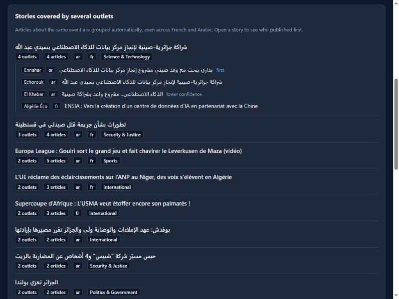
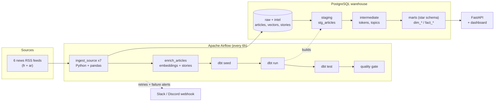

# DZ News Pulse

**What is Algerian news talking about today?**
An automated data pipeline that collects headlines from six Algerian news sites (French and Arabic), sorts them into topics, finds the trending keywords, and serves the results through an API and a small dashboard.

Beyond listing headlines, it **groups articles about the same event into stories**, even when they come from different outlets and different languages, using a local multilingual embedding model. There are no paid APIs anywhere: all intelligence runs on the CPU.

It is also a complete, production-style example of a modern batch **ELT** stack: Airflow, Python/pandas, dbt, PostgreSQL, FastAPI and Docker. The whole thing starts with one command.

```bash
docker compose up --build
```

| What | Where |
|---|---|
| Airflow (the pipeline) | http://localhost:8080 &nbsp;(`admin` / `admin`, local only) |
| Dashboard | http://localhost:8000 |
| API docs (Swagger) | http://localhost:8000/docs |
| Warehouse (PostgreSQL) | `localhost:5433` &nbsp;(`news` / `news` / `news`) |

> The first run downloads the open-source embedding model (about 1 GB, cached in a Docker volume) and the Airflow image is large, so the first `up --build` takes several minutes. Budget roughly 3 GB of free RAM.
>
> The first Airflow run starts automatically. After the DAG turns green (about a minute) the dashboard fills up. Until then the API answers `503: run the DAG`.

| The DAG after a run: every task green | The dashboard |
|---|---|
|  |  |

---

## What it does, in plain words

1. **Every 6 hours** Airflow downloads the RSS feeds of six sites: Algérie360, Algérie Éco, DzFoot, Echorouk, Ennahar and El Khabar.
2. Python cleans each article (strips HTML, fixes dates, removes duplicates) and stores it **raw** in PostgreSQL.
3. **dbt** turns the raw rows into a tested star schema. In plain SQL it:
   - splits every title and summary into normalised words (French *and* Arabic);
   - assigns each article one of 11 **topics** (Politics, Economy & Energy, Sports, Security & Justice, Health ...) by scoring topic keyword lists;
   - counts the **trending keywords** per day.
4. A local multilingual embedding model turns each article into a vector, and **articles about the same event are grouped into stories** (see below).
5. A final **data-quality gate** fails the run if too few sources worked or nothing new arrived, and an alert goes out on any failure.
6. A **FastAPI** service exposes the results, with a dashboard on top.

```jsonc
// GET /topics?days=7   (example response)
[
  {"topic": "Sports",        "articles": 37, "share_pct": 33.6},
  {"topic": "International", "articles": 21, "share_pct": 19.1},
  {"topic": "Politics & Government", "articles": 11, "share_pct": 10.0},
  ...
]
```

## Stories: one event, many outlets, two languages

When several outlets cover the same event, the dashboard shows it once, with every article, who published first, and how confident the grouping is. For example, a French article, an Arabic article and an English-language item about Algerian gas exports end up in the same story, and so do Arabic and French reports of the Algiers water cut or of a pharmacist's murder in Constantine.

* Embeddings: `paraphrase-multilingual-mpnet-base-v2`, run locally through ONNX Runtime (about 100 ms per article on an old 4-core CPU, no GPU).
* Incremental clustering with a language-aware threshold, a time window, a merge pass, and detection of syndicated copies so they are not counted as independent coverage.
* Measured on hand-labelled real articles: precision 0.93, recall 0.77 (small set, tuned on itself, labels not yet double-checked; details and caveats in [docs/INTELLIGENCE.md](docs/INTELLIGENCE.md)).
* Every grouping stores the evidence behind it, and all thresholds are in [`config/intelligence.yml`](config/intelligence.yml).



## Architecture



### Star schema (`marts`)

| Table | Grain | Purpose |
|---|---|---|
| `fact_articles` | one row per article | the central fact table |
| `fact_topic_daily` | day x topic x language | pre-aggregated topic coverage |
| `fact_keyword_daily` | day x language x keyword | trending words |
| `dim_source` | one row per website | name, language, focus |
| `dim_topic` | one row per topic | names in English, French and Arabic |
| `dim_date` | one row per day | calendar (Algerian weekend = Fri/Sat) |
| `dim_story` | one row per story | headline, outlets, languages, topic, coverage statistics |
| `bridge_story_article` | one row per assigned article | which story, with similarity and confidence |

## Engineering decisions worth a look

- **Idempotent loads.** The article id is a hash of the canonical URL (tracking parameters stripped) and the insert is `ON CONFLICT DO NOTHING`. Re-running a DAG or scraping the same feed twice never creates duplicates.
- **One broken website never blocks the rest.** Ingestion is a dynamically mapped Airflow task, one per source, with 3 retries and exponential back-off. dbt still runs if one source is down, and the final quality gate decides whether the run is healthy.
- **Everything is in the audit trail.** `raw.ingestion_log` records fetched, rejected and inserted counts, status and error for every source on every run. The API exposes it at `/pipeline/runs`.
- **Messy real-world data is handled.** One site uses a non-standard date format (`20:07 | 08-11-2026`) and WordPress footers leak into summaries. Both have dedicated, unit-tested handling in [`transform.py`](pipeline/dznews/transform.py).
- **Bilingual NLP with no libraries, just SQL.** [`normalize.sql`](dbt/macros/normalize.sql) strips French accents and unifies Arabic letter variants, diacritics and the "al-" prefix. The same macros normalise tokens, keywords and stop-words, so they always compare equal. It also doesn't depend on the database locale.
- **Transparent topic model.** Topics come from an editable keyword list ([`topic_keywords.csv`](dbt/seeds/topic_keywords.csv)), not a black box. Title matches count double. Anyone can read why an article landed in a topic, and improving the model is a CSV edit.
- **Single source of truth.** [`news_sources.csv`](dbt/seeds/news_sources.csv) is both a dbt seed and the list the Python code ingests from.
- **Tested at every layer.** 74 pytest tests (cleaning, dates, dedup, seeds, API, clustering logic, French/Arabic text handling) plus one slow quality-regression test on the labelled real articles, 54 dbt tests (unique, not-null, accepted values, referential integrity, row-count reconciliation between layers), a data-quality gate in the DAG, and a CI pipeline that runs `dbt build` against a real PostgreSQL.
- **Reproducible.** Pinned Airflow and dbt versions. dbt and the NLP stage each run in their own virtualenv inside the Airflow image, so their dependencies never clash with Airflow's.
- **Schema migrations.** Numbered SQL files applied once and recorded in `schema_migrations` (`pipeline/dznews/migrations/`); existing data is preserved when the schema evolves.
- **Incremental NLP.** Each article's processing status, model and version are stored, so only new articles are embedded; one failing article never stops the rest.

## Project layout

```
airflow/dags/dz_news_pulse.py     the DAG
pipeline/dznews/                  ingestion + NLP code: extract, transform, load, embeddings, stories, evaluate, CLI
pipeline/dznews/migrations/       numbered SQL migrations
config/intelligence.yml           clustering thresholds (tunable without code changes)
evaluation/gold_stories.json      hand-labelled real articles used to measure clustering quality
docs/INTELLIGENCE.md              how stories are detected, with measured quality
dbt/
  models/staging|intermediate|marts
  seeds/                          sources, topics, topic keywords, stop-words
  macros/                         text normalisation, schema naming
  tests/                          singular data tests
api/app/                          FastAPI service + dashboard
docker/  docker-compose.yml       the whole stack
sample_data/                      synthetic feeds for offline demos, tests and CI
tests/                            pytest suite
.github/workflows/ci.yml          lint + tests + dbt build + docker build
```

## Run it without Docker

```bash
pip install -r requirements-dev.txt dbt-core==1.12.6 dbt-postgres==1.9.0
pytest -q                                   # unit tests, no database or model needed
pytest -m slow                              # clustering quality on real articles (downloads the model once)

# with any PostgreSQL reachable through the WAREHOUSE_* variables (see .env.example):
export PYTHONPATH=pipeline
python -m dznews.cli ingest                 # fetch the live feeds   (or: load-sample)
python -m dznews.cli enrich                 # embed new articles and group them into stories
python -m dznews.cli evaluate               # score the clustering on the labelled set
cd dbt && dbt seed --profiles-dir . && dbt run --profiles-dir . && dbt test --profiles-dir .
cd ../api && uvicorn app.main:app           # dashboard on :8000
```

`python -m dznews.cli load-sample` loads **synthetic** fixtures from `sample_data/`, which is handy for an offline demo and is what CI uses.

## Configuration

| Variable | Purpose | Default |
|---|---|---|
| `WAREHOUSE_HOST/PORT/DB/USER/PASSWORD` | warehouse connection | see `.env.example` |
| `ALERT_WEBHOOK_URL` | Slack/Discord webhook for failed tasks | empty (log only) |
| `EMBEDDING_MODEL` | embedding model used for stories | `sentence-transformers/paraphrase-multilingual-mpnet-base-v2` |
| `config/intelligence.yml` | clustering thresholds and weights | see file |

## Limitations (and what I would do next)

- RSS only exposes each site's latest 10 to 50 articles, so history builds up from the first run onwards. Only three of the seven feeds publish full article text.
- Story detection is algorithmic and imperfect (see the measured quality above). It misses links that depend on nicknames, such as "Fennecs" and "الخضر"; entity aliases are the planned fix.
- Topic detection is keyword-based. It is explainable and fast, but it misses context. A natural next step is to benchmark it against a small hand-labelled set, then try a multilingual embedding model.
- Keywords are single normalised words. Phrase detection (n-grams) and Arabic stemming beyond "al-" would sharpen the trending list.
- `LocalExecutor` suits this scale. Larger volumes would move to the Celery or Kubernetes executor, and the warehouse to a managed Postgres.
- Respect each website's terms of use. This project only reads public RSS feeds, identifies itself with a User-Agent, and stores headlines plus short summaries with a link back to the source.

## License

MIT, see [LICENSE](LICENSE).
