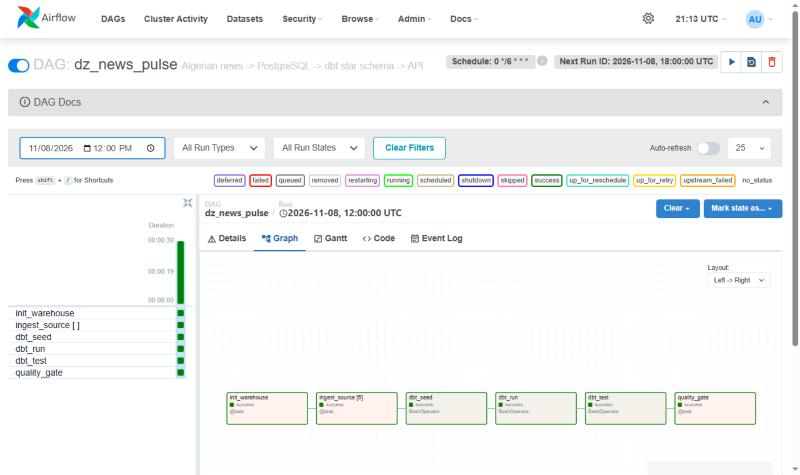
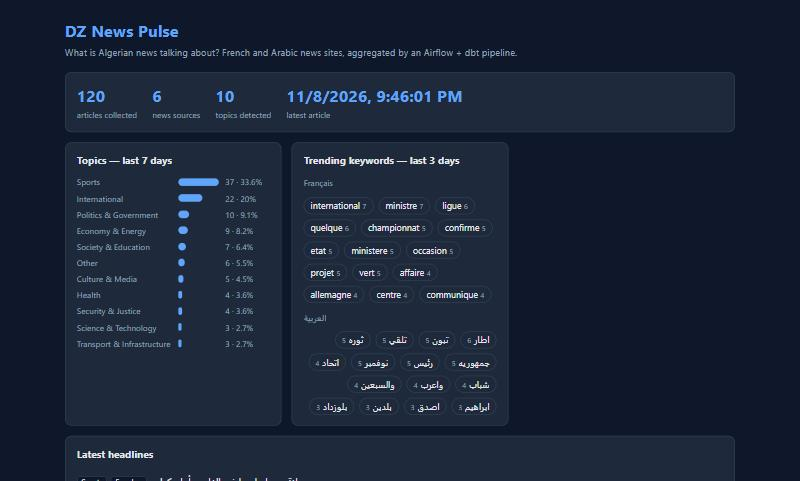
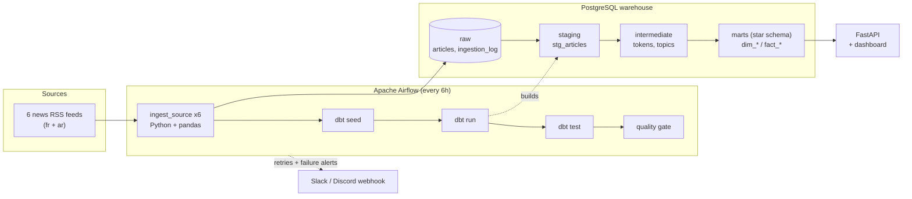

# DZ News Pulse

**What is Algerian news talking about today?**
An automated data pipeline that collects headlines from six Algerian news sites (French and Arabic), sorts them into topics, finds the trending keywords, and serves the results through an API and a small dashboard.

It is also a complete, production-style example of a modern batch **ELT** stack: Airflow, Python/pandas, dbt, PostgreSQL, FastAPI and Docker. The whole thing starts with one command.

```bash
docker compose up --build
```

| What | Where |
|---|---|
| Airflow (the pipeline) | http://localhost:8080 &nbsp;(`admin` / `admin`, local only) |
| Dashboard | http://localhost:8000 |
| API docs (Swagger) | http://localhost:8000/docs |
| Warehouse (PostgreSQL) | `localhost:5433` &nbsp;(`news` / `news` / `news`) |

> The first Airflow run starts automatically. After the DAG turns green (about a minute) the dashboard fills up. Until then the API answers `503: run the DAG`.

| The DAG after a run: every task green | The dashboard |
|---|---|
|  |  |

---

## What it does, in plain words

1. **Every 6 hours** Airflow downloads the RSS feeds of six sites: Algérie360, Algérie Éco, DzFoot, Echorouk, Ennahar and El Khabar.
2. Python cleans each article (strips HTML, fixes dates, removes duplicates) and stores it **raw** in PostgreSQL.
3. **dbt** turns the raw rows into a tested star schema. In plain SQL it:
   - splits every title and summary into normalised words (French *and* Arabic);
   - assigns each article one of 11 **topics** (Politics, Economy & Energy, Sports, Security & Justice, Health ...) by scoring topic keyword lists;
   - counts the **trending keywords** per day.
4. A final **data-quality gate** fails the run if too few sources worked or nothing new arrived, and an alert goes out on any failure.
5. A **FastAPI** service exposes the results, with a dashboard on top.

```jsonc
// GET /topics?days=7   (example response)
[
  {"topic": "Sports",        "articles": 37, "share_pct": 33.6},
  {"topic": "International", "articles": 21, "share_pct": 19.1},
  {"topic": "Politics & Government", "articles": 11, "share_pct": 10.0},
  ...
]
```

## Architecture



### Star schema (`marts`)

| Table | Grain | Purpose |
|---|---|---|
| `fact_articles` | one row per article | the central fact table |
| `fact_topic_daily` | day x topic x language | pre-aggregated topic coverage |
| `fact_keyword_daily` | day x language x keyword | trending words |
| `dim_source` | one row per website | name, language, focus |
| `dim_topic` | one row per topic | names in English, French and Arabic |
| `dim_date` | one row per day | calendar (Algerian weekend = Fri/Sat) |

## Engineering decisions worth a look

- **Idempotent loads.** The article id is a hash of the canonical URL (tracking parameters stripped) and the insert is `ON CONFLICT DO NOTHING`. Re-running a DAG or scraping the same feed twice never creates duplicates.
- **One broken website never blocks the rest.** Ingestion is a dynamically mapped Airflow task, one per source, with 3 retries and exponential back-off. dbt still runs if one source is down, and the final quality gate decides whether the run is healthy.
- **Everything is in the audit trail.** `raw.ingestion_log` records fetched, rejected and inserted counts, status and error for every source on every run. The API exposes it at `/pipeline/runs`.
- **Messy real-world data is handled.** One site uses a non-standard date format (`20:07 | 08-11-2026`) and WordPress footers leak into summaries. Both have dedicated, unit-tested handling in [`transform.py`](pipeline/dznews/transform.py).
- **Bilingual NLP with no libraries, just SQL.** [`normalize.sql`](dbt/macros/normalize.sql) strips French accents and unifies Arabic letter variants, diacritics and the "al-" prefix. The same macros normalise tokens, keywords and stop-words, so they always compare equal. It also doesn't depend on the database locale.
- **Transparent topic model.** Topics come from an editable keyword list ([`topic_keywords.csv`](dbt/seeds/topic_keywords.csv)), not a black box. Title matches count double. Anyone can read why an article landed in a topic, and improving the model is a CSV edit.
- **Single source of truth.** [`news_sources.csv`](dbt/seeds/news_sources.csv) is both a dbt seed and the list the Python code ingests from.
- **Tested at every layer.** 39 pytest tests (cleaning, dates, dedup, seeds, API), 40 dbt tests (unique, not-null, accepted values, referential integrity, row-count reconciliation between layers), a data-quality gate in the DAG, and a CI pipeline that runs `dbt build` against a real PostgreSQL.
- **Reproducible.** Pinned Airflow and dbt versions. dbt runs in its own virtualenv inside the Airflow image so dependencies never clash.

## Project layout

```
airflow/dags/dz_news_pulse.py     the DAG
pipeline/dznews/                  ingestion code: extract, transform, load, quality, alerts, CLI
dbt/
  models/staging|intermediate|marts
  seeds/                          sources, topics, topic keywords, stop-words
  macros/                         text normalisation, schema naming
  tests/                          singular data tests
api/app/                          FastAPI service + dashboard
docker/  docker-compose.yml       the whole stack
sample_data/                      synthetic feeds for offline demos, tests and CI
tests/                            pytest suite
.github/workflows/ci.yml          lint + tests + dbt build + docker build
```

## Run it without Docker

```bash
pip install -r requirements-dev.txt dbt-core==1.12.6 dbt-postgres==1.9.0
pytest -q                                   # 39 unit tests, no database needed

# with any PostgreSQL reachable through the WAREHOUSE_* variables (see .env.example):
export PYTHONPATH=pipeline
python -m dznews.cli ingest                 # fetch the live feeds   (or: load-sample)
cd dbt && dbt seed --profiles-dir . && dbt run --profiles-dir . && dbt test --profiles-dir .
cd ../api && uvicorn app.main:app           # dashboard on :8000
```

`python -m dznews.cli load-sample` loads **synthetic** fixtures from `sample_data/`, which is handy for an offline demo and is what CI uses.

## Configuration

| Variable | Purpose | Default |
|---|---|---|
| `WAREHOUSE_HOST/PORT/DB/USER/PASSWORD` | warehouse connection | see `.env.example` |
| `ALERT_WEBHOOK_URL` | Slack/Discord webhook for failed tasks | empty (log only) |

## Limitations (and what I would do next)

- RSS only exposes each site's latest 10 to 50 articles, so history builds up from the first run onwards.
- Topic detection is keyword-based. It is explainable and fast, but it misses context. A natural next step is to benchmark it against a small hand-labelled set, then try a multilingual embedding model.
- Keywords are single normalised words. Phrase detection (n-grams) and Arabic stemming beyond "al-" would sharpen the trending list.
- `LocalExecutor` suits this scale. Larger volumes would move to the Celery or Kubernetes executor, and the warehouse to a managed Postgres.
- Respect each website's terms of use. This project only reads public RSS feeds, identifies itself with a User-Agent, and stores headlines plus short summaries with a link back to the source.

## License

MIT, see [LICENSE](LICENSE).
